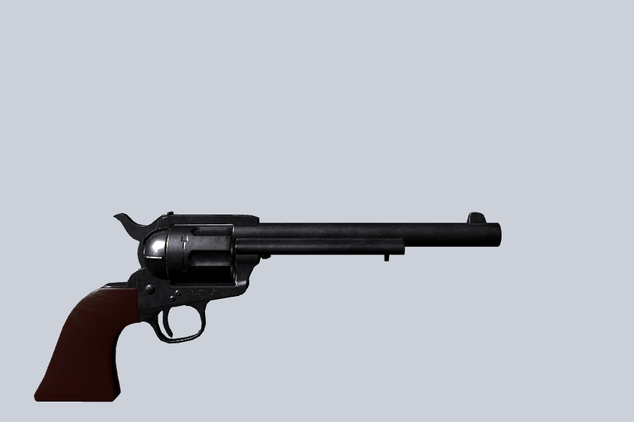

# WesternVR

Single-player VR Western for Meta Quest, in Godot 4.7 (GDScript, Mobile
renderer, OpenXR). **Pass 1:** one Colt Single Action Army (1873, .45 Colt,
7.5" barrel, 1.05 kg), simulated as closely as we could, on a small test range.



Model: "Colt Single Action Army" by Foxx Assets, CC-BY 4.0 (see CREDITS.md).

## Run it
- **Quest Link:** open the project in Godot 4.7, put the headset on Link,
  press Play (main scene `main/Main.tscn`).
- **Export to Quest:** install **Godot OpenXR Vendors** from the Asset
  Library (it is a binary add-on, so it isn't in this repo), enable it under
  Project Settings > Plugins, add an Android export preset with Gradle build,
  XR Mode = OpenXR and the Meta XR plugin enabled.

## Controls (defaults; change them on the `Revolver` node, "Controls" group)

| Hand holding the gun by the grip | |
|---|---|
| Grip (hold) | hold the gun; release to drop / throw |
| Trigger | pull the trigger (fires only at full cock) |
| A / X | thumb the hammer to full cock (two clicks, cylinder turns) |
| B / Y | hammer down: half-cock; otherwise lower the hammer |
| Thumbstick click | open / close the loading gate |
| Thumbstick left/right flick | turn the cylinder one chamber (half-cock + gate open) |
| Right thumbstick (no gun, or gate shut) | snap turn 30 deg |

| Other hand | |
|---|---|
| Grip in the ammo box | take one cartridge |
| Bring a cartridge to the open gate | it slides into the empty chamber |
| Trigger, hand near the ejector rod head | push the ejector rod: ejects the case at the gate |

**Reloading the SAA way:** B (half-cock), stick click (open gate), other hand
on the ejector + trigger (case out), flick (next chamber)... take a round from
the box, bring it to the gate, stick click (close), A (cock), fire. The gun
starts with five rounds and the hammer on the empty sixth chamber.

## Project layout

| Path | What |
|---|---|
| `player/` | XR rig: `Player.tscn` (XROrigin3D, camera, XR Tools collision hands, snap turn), `FrameRateGuard.gd` (90 Hz, falls back to 72) |
| `interaction/` | `Grabbable.gd` (rigid body held by forces), `HandGrabber.gd` (grip to grab, input, haptics), `Surface.gd` |
| `revolver/` | `Revolver.tscn` / `Revolver.gd` (the gun), `RevolverMechanism.gd` (pure lockwork rules), `RevolverAudio.gd`, `RevolverSpec.gd` (real dimensions), `RevolverPlaceholder.tscn` (model) |
| `ballistics/` | `Ballistics.gd` (drop, drag, zeroing, ricochet maths), `BulletTracer.gd` (autoload `Bullets`) |
| `effects/` | `ImpactEffects.gd` (autoload `Impacts`: particles + decals), `MuzzleEffects.gd`, `Wind.gd` |
| `audio/` | `SoundPool.gd` (autoload), `SoundLibrary.gd`, `ProceduralSounds.gd`, `generated/` placeholders, `sounds/` real recordings |
| `ammo/` | `Cartridge.tscn` (round or spent case), `AmmoBoxBody.tscn` |
| `range/` | `Range.tscn` test range |
| `tests/` | GUT tests |
| `tools/` | scene generator, test/check scripts, snapshot renderer |

New weapons reuse `Grabbable`, `HandGrabber`, `Ballistics`, `Bullets`,
`Impacts` and `SoundPool`; only the gun-specific mechanism, audio map and
model are new.

## Tests and checks

Set `GODOT` to your Godot 4.7 executable first.

Windows:
```
set GODOT=C:\path\to\godot.exe
tools\test.bat
```
Linux/macOS:
```bash
GODOT=/path/to/godot tools/test.sh
```
- `tools/test.*` runs all GUT tests headless (`-gselect=test_mechanism` for one file).
- `tools/check.*` loads the project and runs the main scene headless.
- `tools/gate.sh` = regenerate + check + tests; it's what each step was committed on.
- `tools/build.*` regenerates the generated scenes from `tools/scene_builders.gd`
  (**overwrites** them; once you edit scenes by hand in the editor, stop
  using it or move your change into the builder).

## Tuning knobs

| Want to change | Where |
|---|---|
| How the gun sits in the hand | `Revolver/GripPoint` rotation (default -15 deg) |
| Recoil strength / flip / settling | `Revolver` > Recoil |
| Hold stiffness, max force | `Revolver` > Holding |
| Buttons | `Revolver` > Controls |
| Muzzle velocity, zero distance | `Revolver` > Ballistics |
| Snap vs smooth turn | `Player/RightHand/MovementTurn` turn_mode |
| Refresh rate (90 / 72) | `Main/FrameRateGuard` preferred_rate |
| Wind for smoke | `Range` wind |
| Shot loudness, echo levels | `Revolver/Audio` |

See `docs/ASSETS.md` for real models and sounds, `docs/VR_CHECKLIST.md` for
what to test in the headset, and `CREDITS.md` for licences.
